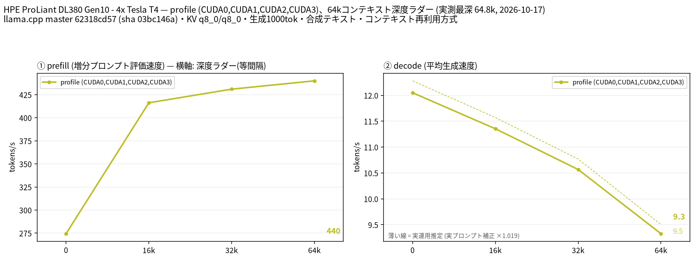
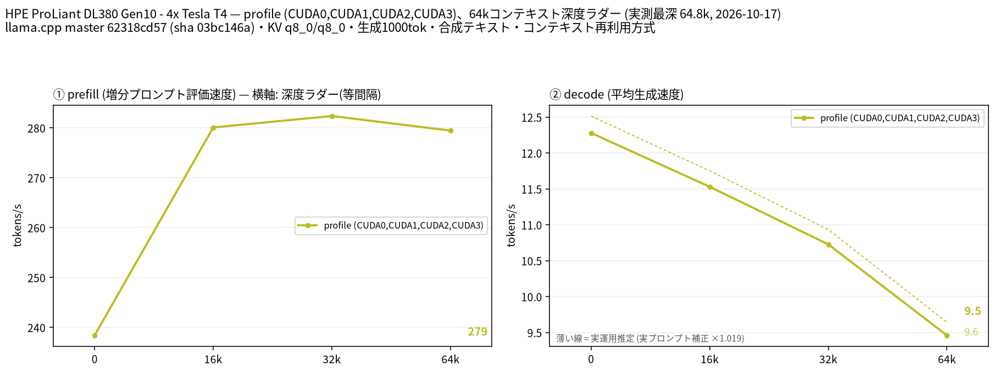

# Tesla T4 4 枚で Nemotron 3.5 Super VL 120B-A12B の UD-IQ2_XXS と UD-IQ2_M を 64k コンテキストまで計測

- **作成者**: MG8853
- **作成日**: 2026-10-17

## 概要

HPE ProLiant DL380 Gen10 に Tesla T4 × 4（15 GB / 枚）を載せた構成で、NVIDIA Nemotron 3.5 Super VL 120B-A12B（総 120B / アクティブ 12B、アーキテクチャ `nemotron_h_moe`、89 ブロック、エキスパート 512 / 使用 22）の Unsloth UD-IQ2_XXS（47.6 GiB）と UD-IQ2_M（52.0 GiB）を、CUDA0〜CUDA3 の layer 分割で 64k コンテキストまで計測しました。テキスト入力のみ（mmproj は読み込んでいません）で、この GGUF に MTP ヘッドがないため投機的デコードは使っていません。
64k で IQ2_XXS は prefill 440.0 t/s / decode 9.33 t/s、IQ2_M は prefill 279.5 t/s / decode 9.46 t/s でした。decode は両量子化でほぼ同等、prefill は IQ2_XXS が 1.5〜1.6 倍速い結果です。
VRAM は IQ2_XXS が最大 13.5 GiB / 枚、IQ2_M が最大 14.5 GiB / 枚で、T4 1 枚 15 GiB（15,360 MiB）では IQ2_M の 64k がほぼ上限です。

## ハードウェア

| 項目 | 内容 |
|------|------|
| コンピュータ / マザーボード | HPE ProLiant DL380 Gen10 |
| GPU | Tesla T4 × 4（VRAM 15,360 MiB / 枚、電力上限 70 W / 枚） |
| GPU 接続 | PCIe 3.0 x16（`nvidia-smi` の current はアイドル時 Gen1 x16、max は Gen3 x16）。NVLink なし。`nvidia-smi topo -m` では GPU0-GPU1 が NODE、GPU2-GPU3 が NODE、この 2 組の間は SYS（NUMA ノードをまたぐ） |
| CPU | Intel Xeon Gold 6254 × 2（18 コア / 36 スレッド × 2。この環境でオンラインなのは 36 論理 CPU） |
| メモリ | 232 GiB |
| 電源 | 不明 |

## ソフトウェア環境

| 項目 | 内容 |
|------|------|
| OS | Ubuntu 26.04.1 LTS / Linux 7.0.14-14-pve |
| GPU ドライバ | 615.71.09（CUDA UMD 13.4） |
| llama.cpp | master 62318cd57（version 0.7.0-dev build 11709、2026-10-17）、CUDA バックエンド（CUDA 13.2、`CMAKE_CUDA_ARCHITECTURES=75`、`GGML_CUDA_FA=ON`、`GGML_CUDA_FA_ALL_QUANTS=ON`、`GGML_CUDA_NCCL=ON`、Release / GCC 15.2.0）。計測前に build 11195（d834d44e6）から更新しています |

## ベンチマーク

### 条件

| 項目 | 内容 |
|------|------|
| ツール | llama-split-bench 7af72d4 |
| モデル | `unsloth/NVIDIA-Nemotron-3.5-Super-VL-120B-A12B-GGUF` の UD-IQ2_XXS（3 シャード計 51,120,348,072 バイト = 47.6 GiB）と UD-IQ2_M（3 シャード計 55,876,393,864 バイト = 52.0 GiB）。総 120B / アクティブ 12B の MoE（`nemotron_h_moe`、89 ブロック、エキスパート 512 / 使用 22、GGUF 上のコンテキスト長 1,048,576） |
| 測定モード | profile（CUDA0〜CUDA3 の 4 枚、layer 分割）。モデルが T4 1 枚（15 GB）に収まらないため単一 GPU の比較はしていません（`VS_PANEL=off`） |
| ctx / stages | 65536 / 0,16000,32000,64000 |
| KV キャッシュ | q8_0 / q8_0 |
| 投機的デコード | なし（この GGUF は nextn / MTP 層を含まないため `SPEC_ARGS=""`） |
| その他 | テキストのみ（`--mmproj` なし。画像入力は未計測）、`-fa on`、`-ngl all`、`-t 16`、`--parallel 1`、`--jinja`、`--cache-ram 8192 --cache-idle-slots`、生成 1000 トークン / 段（64k 段はコンテキスト上限に達し 751 トークン）、PORT 18081、`LAUNCH_PREFIX` なし |

### 結果

単位は t/s です。depth 0 の prefill は新規プロンプト（pp2048）の値です。ラダー初段（11 トークン）の prefill は計測上のアーティファクトなので表に載せていません。64k 段の decode は、生成上限 1,000 トークンに対してコンテキスト上限に達したため 751 トークンでの測定です。

| depth | IQ2_XXS prefill | IQ2_XXS decode | IQ2_M prefill | IQ2_M decode |
|------:|------:|------:|------:|------:|
| 0 | 274.4 | 12.05 | 238.4 | 12.28 |
| 16k | 416.2 | 11.35 | 280.1 | 11.53 |
| 32k | 431.0 | 10.57 | 282.4 | 10.73 |
| 64k | 440.0 | 9.33 | 279.5 | 9.46 |

### 所感

- decode は両量子化でほぼ同じでした。depth 0 で 12.05 / 12.28 t/s、64k で 9.33 / 9.46 t/s で、IQ2_M がわずかに速い程度です。アクティブ 12B の MoE で、重みの読み出し量より計算と KV アクセスが支配的なためと考えられます。
- prefill は IQ2_XXS が明確に速い結果でした。32k で 431.0 対 282.4 t/s、64k で 440.0 対 279.5 t/s と、IQ2_XXS が 1.5〜1.6 倍です。IQ2_M はファイルが 4.6 GiB 大きいだけでなく、2-bit と 3-bit のテンソルが混在する構成のため、dequant と行列積のコストが増えている可能性があります。
- 実プロンプト補正係数は IQ2_XXS が 1.019、IQ2_M が 1.019 で、どちらもほぼ 1 です。合成ラダーの decode 値がそのまま実運用の目安になります。
- depth 0 の prefill（pp2048）よりラダーの増分 prefill のほうが速いのは、短い新規プロンプトでは重みの読み込みが支配的で、長いプロンプトではバッチ処理が効くためです。
- VRAM は IQ2_XXS が最大 13.5 GiB / 枚、IQ2_M が最大 14.5 GiB / 枚でした。llama.cpp は起動時に `-c` 分の KV キャッシュを確保するため、IQ2_M の 64k はほぼ T4 1 枚の上限です。これより長いコンテキストを狙う場合は `--n-cpu-moe` によるエキスパートの CPU オフロードや KV キャッシュのさらなる量子化が必要になります。
- GGUF メタデータ上のコンテキスト長は 1,048,576 ですが、4×T4 の VRAM では 64k までを計測しています。tensor 分割はこのモデルでは試していません。
- このモデルは vision-language モデルですが、今回はテキスト入力のみで、mmproj（`mmproj-BF16.gguf`）は読み込んでいません。画像入力の速度は未計測です。

## 添付

- UD-IQ2_XXS
  - [run-info.json](attachment/2026-10-17_221656_profiling_nemotron_3.5_super_vl_120b_a12b_on_4x_tesla_t4/iq2_xxs/run-info.json)
  - [results-profile.json](attachment/2026-10-17_221656_profiling_nemotron_3.5_super_vl_120b_a12b_on_4x_tesla_t4/iq2_xxs/results-profile.json) / [results-profile-pp0.json](attachment/2026-10-17_221656_profiling_nemotron_3.5_super_vl_120b_a12b_on_4x_tesla_t4/iq2_xxs/results-profile-pp0.json) / [results-real.json](attachment/2026-10-17_221656_profiling_nemotron_3.5_super_vl_120b_a12b_on_4x_tesla_t4/iq2_xxs/results-real.json)
  - [argv-profile.txt](attachment/2026-10-17_221656_profiling_nemotron_3.5_super_vl_120b_a12b_on_4x_tesla_t4/iq2_xxs/argv-profile.txt)
- UD-IQ2_M
  - [run-info.json](attachment/2026-10-17_221656_profiling_nemotron_3.5_super_vl_120b_a12b_on_4x_tesla_t4/iq2_m/run-info.json)
  - [results-profile.json](attachment/2026-10-17_221656_profiling_nemotron_3.5_super_vl_120b_a12b_on_4x_tesla_t4/iq2_m/results-profile.json) / [results-profile-pp0.json](attachment/2026-10-17_221656_profiling_nemotron_3.5_super_vl_120b_a12b_on_4x_tesla_t4/iq2_m/results-profile-pp0.json) / [results-real.json](attachment/2026-10-17_221656_profiling_nemotron_3.5_super_vl_120b_a12b_on_4x_tesla_t4/iq2_m/results-real.json)
  - [argv-profile.txt](attachment/2026-10-17_221656_profiling_nemotron_3.5_super_vl_120b_a12b_on_4x_tesla_t4/iq2_m/argv-profile.txt)
