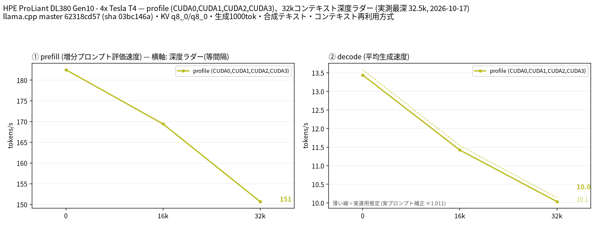

# Tesla T4 4 枚で Qwen3.8-Flash-Next の AD-3.84bpw-IQ4_XS-M64 を 32k コンテキストで計測

- **作成者**: MG8853
- **作成日**: 2026-10-17

## 概要

HPE ProLiant DL380 Gen10 に Tesla T4 × 4（15 GB / 枚）を載せた構成で、Qwen3.8-Flash-Next（177B、アーキテクチャ `qwen4exp`、48 ブロック、エキスパート 512 / 使用 10）の `AD-3.84bpw-IQ4_XS-M64`（AtomicChat、28 シャード計 79.1 GiB）を、CUDA0〜CUDA3 の layer 分割で 32k コンテキストまで計測しました。
79.1 GiB は 4×T4 の VRAM 60 GiB に収まらないため、`--n-cpu-moe 4` で 4 層分のエキスパートを CPU に置いています。この条件で depth 0 の decode 13.44 t/s、prefill（pp2048）182.5 t/s、32k で decode 10.03 t/s / prefill 150.7 t/s でした。GPU の使用量は合計約 42 GiB で、モデルカードにある 39 GB の n-gram ルックアップテーブルは GPU に載らずホスト側に残っているとみられます。

## ハードウェア

| 項目 | 内容 |
|------|------|
| コンピュータ / マザーボード | HPE ProLiant DL380 Gen10 |
| GPU | Tesla T4 × 4（VRAM 15,360 MiB / 枚、電力上限 70 W / 枚） |
| GPU 接続 | PCIe 3.0 x16（`nvidia-smi` の current はアイドル時 Gen1 x16、max は Gen3 x16）。NVLink なし。`nvidia-smi topo -m` では GPU0-GPU1 が NODE、GPU2-GPU3 が NODE、この 2 組の間は SYS（NUMA ノードをまたぐ） |
| CPU | Intel Xeon Gold 6254 × 2（18 コア / 36 スレッド × 2。この環境でオンラインなのは 36 論理 CPU） |
| メモリ | 232 GiB |
| 電源 | 不明 |

## ソフトウェア環境

| 項目 | 内容 |
|------|------|
| OS | Ubuntu 26.04.1 LTS / Linux 7.0.14-14-pve |
| GPU ドライバ | 615.71.09（CUDA UMD 13.4） |
| llama.cpp | master 62318cd57（version 0.7.0-dev build 11709、2026-10-17）、CUDA バックエンド（CUDA 13.2、`CMAKE_CUDA_ARCHITECTURES=75`、`GGML_CUDA_FA=ON`、`GGML_CUDA_FA_ALL_QUANTS=ON`、`GGML_CUDA_NCCL=ON`、Release / GCC 15.2.0） |

## ベンチマーク

### 条件

| 項目 | 内容 |
|------|------|
| ツール | llama-split-bench 7af72d4 |
| モデル | `AtomicChat/Qwen3.8-Flash-Next-GGUF` の AD-3.84bpw-IQ4_XS-M64（28 シャード計 84,930,924,160 バイト = 79.1 GiB）。177B、`qwen4exp`、48 ブロック、エキスパート 512 / 使用 10、GGUF 上のコンテキスト長 262,144。モデルカードによると 51B パラメータ分は n-gram ルックアップテーブル（約 39 GB） |
| 測定モード | profile（CUDA0〜CUDA3 の 4 枚、layer 分割）。`--n-cpu-moe 4` で最初の 4 層の MoE エキスパートを CPU に配置。単一 GPU 比較はなし（`VS_PANEL=off`） |
| ctx / stages | 32768 / 0,16000,32000 |
| KV キャッシュ | q8_0 / q8_0 |
| 投機的デコード | なし（`SPEC_ARGS=""`） |
| その他 | テキストのみ（`--mmproj` なし。画像入力は未計測）、`-fa on`、`-ngl all`、`-t 16`、`--parallel 1`、`--jinja`、`--cache-ram 8192 --cache-idle-slots`、生成 1000 トークン / 段（32k 段はコンテキスト上限に達し 310 トークン）、PORT 18081、`LAUNCH_PREFIX` なし |

### 結果

単位は t/s です。depth 0 の prefill は新規プロンプト（pp2048）の値です。ラダー初段（11 トークン）の prefill は計測上のアーティファクトなので表に載せていません。32k 段の decode は、プロンプト 32,458 トークンと生成分の合計が ctx 32,768 に達するため 310 トークンでの測定です（生成上限は 1,000 トークン）。

| depth | prefill | decode |
|------:|------:|------:|
| 0 | 182.5 | 13.44 |
| 16k | 169.4 | 11.42 |
| 32k | 150.7 | 10.03 |

### 所感

- 79.1 GiB のモデルを 4×T4（60 GiB）で動かすため、`--n-cpu-moe 4` で 4 層分のエキスパートだけを CPU に置きました。GPU の使用量は 9.5 / 10.7 / 10.7 / 11.4 GiB で、4 枚とも余裕があります。CPU 側には約 40 GiB の重みが残ります。
- `--n-cpu-moe 14` も予備の smoke 実行（ctx 8,192、深さ約 4k、64 トークン生成）で試しましたが、GPU0 だけが 2.2 GiB と極端に空き、prefill 139.7 t/s / decode 12.68 t/s と `--n-cpu-moe 4`（177.8 / 14.91）より遅くなりました。最初の N 層だけを CPU に置く仕様のため、N を増やすと GPU0 のエキスパートだけが消えて偏るのが原因です。4 層がこの構成でのバランス点でした。両方の生データは添付の `n-cpu-moe-14/` と `n-cpu-moe-4/` にあります。
- decode は depth 0 の 13.44 t/s から 32k で 10.03 t/s へ緩やかに低下します。prefill は 182.5 → 150.7 t/s で、32k 程度なら実用範囲です。
- 実プロンプト補正係数は 1.011 で、合成ラダーの decode 値がそのまま実運用の目安になります。
- GPU の使用量が合計約 42 GiB とファイルサイズ（79.1 GiB）より大幅に少ないのは、モデルカードにある 39 GB の n-gram ルックアップテーブルが GPU に載らず、ホストのページキャッシュから読まれているためと考えられます（推測）。このテーブルはトークンごとに少量だけ読む設計で、CPU 側にあっても decode を大きく妨げていません。
- GGUF メタデータ上のコンテキスト長は 262,144 ですが、今回は 32k までを計測しています。より長いコンテキストは `--n-cpu-moe` の調整や KV キャッシュの量子化で試せる可能性があります。
- このモデルは multimodal（image-text-to-text）ですが、今回はテキスト入力のみで、mmproj は読み込んでいません。

## 添付

- [run-info.json](attachment/2026-10-17_222953_profiling_qwen3.8_flash_next_ad_3.84bpw_iq4_xs_m64_on_4x_tesla_t4/run-info.json)
- [results-profile.json](attachment/2026-10-17_222953_profiling_qwen3.8_flash_next_ad_3.84bpw_iq4_xs_m64_on_4x_tesla_t4/results-profile.json) / [results-profile-pp0.json](attachment/2026-10-17_222953_profiling_qwen3.8_flash_next_ad_3.84bpw_iq4_xs_m64_on_4x_tesla_t4/results-profile-pp0.json) / [results-real.json](attachment/2026-10-17_222953_profiling_qwen3.8_flash_next_ad_3.84bpw_iq4_xs_m64_on_4x_tesla_t4/results-real.json)
- [argv-profile.txt](attachment/2026-10-17_222953_profiling_qwen3.8_flash_next_ad_3.84bpw_iq4_xs_m64_on_4x_tesla_t4/argv-profile.txt)
- `--n-cpu-moe` の比較（予備 smoke、ctx 8,192、64 トークン生成）
  - n-cpu-moe 14: [argv-profile.txt](attachment/2026-10-17_222953_profiling_qwen3.8_flash_next_ad_3.84bpw_iq4_xs_m64_on_4x_tesla_t4/n-cpu-moe-14/argv-profile.txt) / [results-profile.json](attachment/2026-10-17_222953_profiling_qwen3.8_flash_next_ad_3.84bpw_iq4_xs_m64_on_4x_tesla_t4/n-cpu-moe-14/results-profile.json) / [results-profile-pp0.json](attachment/2026-10-17_222953_profiling_qwen3.8_flash_next_ad_3.84bpw_iq4_xs_m64_on_4x_tesla_t4/n-cpu-moe-14/results-profile-pp0.json) / [run-info.json](attachment/2026-10-17_222953_profiling_qwen3.8_flash_next_ad_3.84bpw_iq4_xs_m64_on_4x_tesla_t4/n-cpu-moe-14/run-info.json)
  - n-cpu-moe 4: [argv-profile.txt](attachment/2026-10-17_222953_profiling_qwen3.8_flash_next_ad_3.84bpw_iq4_xs_m64_on_4x_tesla_t4/n-cpu-moe-4/argv-profile.txt) / [results-profile.json](attachment/2026-10-17_222953_profiling_qwen3.8_flash_next_ad_3.84bpw_iq4_xs_m64_on_4x_tesla_t4/n-cpu-moe-4/results-profile.json) / [results-profile-pp0.json](attachment/2026-10-17_222953_profiling_qwen3.8_flash_next_ad_3.84bpw_iq4_xs_m64_on_4x_tesla_t4/n-cpu-moe-4/results-profile-pp0.json) / [run-info.json](attachment/2026-10-17_222953_profiling_qwen3.8_flash_next_ad_3.84bpw_iq4_xs_m64_on_4x_tesla_t4/n-cpu-moe-4/run-info.json)
