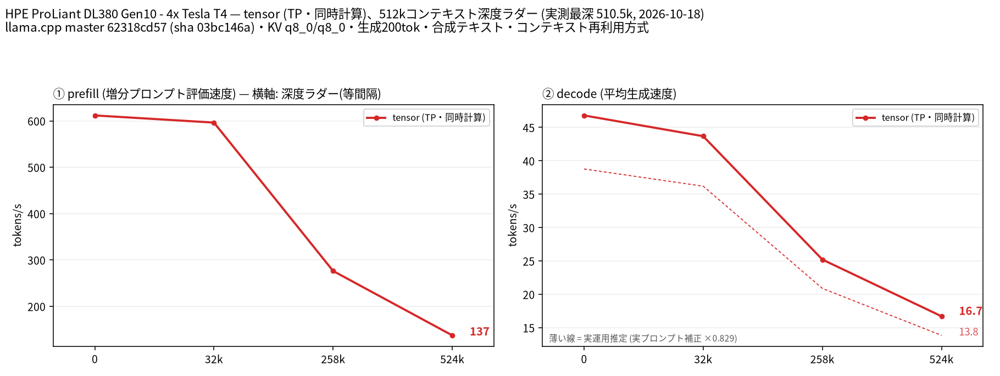

# Tesla T4 4 枚で Qwen3.8 27B Uncensored の 256k/512k と 1M の可否を検証

- **作成者**: MG8853
- **作成日**: 2026-10-18

## 概要

HPE ProLiant DL380 Gen10 + Tesla T4 × 4（15 GB / 枚）で、[JonathanColetti/Qwen3.8-27B-Uncensored-GGUF](https://huggingface.co/JonathanColetti/Qwen3.8-27B-Uncensored-GGUF) の Q5_K_M（19.5 GB）を tensor 分割・KV q8_0・純正 MTP（n-max 2）で 32k / 256k / 512k まで計測しました。ネイティブの 262,144 を超える範囲は YaRN factor 2.0 で拡張しています。

256k で prefill 276.2 t/s / decode 25.2 t/s、512k で 137.3 / 16.7 t/s でした。1M コンテキストは Q5_K_M + q8_0 KV では VRAM 不足でロードできませんでした（Q4_K_M + q4_0 KV も別途確認）。

コーディング評価（HumanEval 164 問、chat 形式、temperature 0）は **156/164 = 95.1%** でした。

## ハードウェア

| 項目 | 内容 |
|------|------|
| コンピュータ / マザーボード | HPE ProLiant DL380 Gen10 |
| GPU | Tesla T4 × 4（VRAM 15,360 MiB / 枚、電力上限 70 W / 枚） |
| GPU 接続 | PCIe 3.0 x16（`nvidia-smi` の current はアイドル時 Gen1 x16、max は Gen3 x16）。NVLink なし。`nvidia-smi topo -m` では GPU0-GPU1 が NODE、GPU2-GPU3 が NODE、この 2 組の間は SYS（NUMA ノードをまたぐ） |
| CPU | Intel Xeon Gold 6254 × 2（18 コア / 36 スレッド × 2。この環境でオンラインなのは 36 論理 CPU） |
| メモリ | 232 GiB |
| 電源 | 不明 |

## ソフトウェア環境

| 項目 | 内容 |
|------|------|
| OS | Ubuntu 26.04.1 LTS / Linux 7.0.14-14-pve |
| GPU ドライバ | 615.71.09（CUDA UMD 13.4） |
| llama.cpp | 0.7.0-dev（build 11709、commit `62318cd57`）、CUDA バックエンド。NCCL 2.30.4 |
| ベンチマーク | llama-split-bench 7af72d4 |

## ベンチマーク

### 条件

| 項目 | 内容 |
|------|------|
| ツール | llama-split-bench 7af72d4 |
| モデル | `Qwen3.8-27B-Uncensored-Q5_K_M.gguf`（19,535,701,408 バイト、ベースは `Qwen/Qwen3.8-27B`、262K コンテキスト、純正 MTP 1 層。PPL 7.1573） |
| 測定モード | tensor（CUDA0〜CUDA3 の 4 枚、TP=4） |
| ctx / stages | 524288 / 0,32000,258000,524000（YaRN factor 2.0、`--yarn-orig-ctx 262144`） |
| KV キャッシュ | q8_0 / q8_0 |
| 投機的デコード | `--spec-type draft-mtp --spec-draft-n-max 2`（モデル内蔵の nextn 1 層） |
| その他 | `-fa on`、`-ngl all`、`-t 16`、`--parallel 1`、`--jinja`、`--cache-ram 8192 --cache-idle-slots --cache-reuse 256`、生成 200 トークン / 段、PORT 18081、`LAUNCH_PREFIX` なし |

### 結果

単位は t/s です。depth 0 の prefill は新規プロンプト（pp2048）の値です。depth 0 の decode と採択率は stage 0（11 トークンのプロンプト、生成 200 トークン）の値です。ラダー初段（11 トークン）の prefill は計測上のアーティファクトなので表に載せていません。

| depth | prefill | decode | MTP 採択率 |
|------:|------:|------:|------:|
| 0 | 611.8 | 46.8 | 0.832 |
| 32k | 596.3 | 43.7 | 0.970 |
| 265k | 276.2 | 25.2 | 0.985 |
| 510k | 137.3 | 16.7 | 0.970 |

### 1M コンテキストの可否

Q5_K_M + q8_0 KV で 1,048,576 コンテキストを確保しようとすると、CUDA0 で 5,220 MiB の追加確保に失敗して `cudaMalloc failed: out of memory` となりました。KV を q4_0 に落としても 1,024 MiB の確保で失敗します。Qwen3.8 27B は dense で KV が大きく、4×T4（15 GiB / 枚）では 1M は現実的ではありません。256k / 512k は q8_0 KV で動作します。

### コーディング評価（HumanEval）

HumanEval の全 164 問を、chat 形式（system で「関数を完成させ、コードブロックのみ返す」と指示）、temperature 0、max_tokens 768、`enable_thinking: false` で解かせ、公式のテストコードを subprocess（10 秒タイムアウト）で実行しました。プロンプト形式は公式の completion 形式ではなく chat 形式なので、公式スコアと直接比較する場合は注意してください。

| 指標 | 結果 |
|------|------|
| pass@1 | **156/164 = 95.1%** |
| 1 問あたりの平均時間 | 5.43 秒 |

同一ハーネス・同一ビルドでの横断比較（HumanEval 164 問、chat 形式、temperature 0）:

| モデル | pass@1 |
|--------|------:|
| Qwen3.8 27B Uncensored Q5_K_M | 156/164 = 95.1% |
| 参考（別モデル）: Ornith-1.5 35B A3B | 147/164 = 89.6% |
| Ornith 1.5 35B A3B Uncensored Q4_K_M | 145/164 = 88.4% |
| Nemotron 3.5 Lightning 30B A3B CRACK Q4_K_M | 143/164 = 87.2% |

## 所感

- 256k で prefill 276.2 / decode 25.2 t/s、512k で 137.3 / 16.7 t/s です。深さが倍になると prefill は約 50%、decode は約 34% 低下します。
- MTP の採択率は 0.97〜0.985 と非常に高く、長コンテキストでも投機デコードがよく効いています。実プロンプトの採択率は 0.564〜0.632、end-to-end は 36.9〜39.7 t/s でした。
- 1M は Q5_K_M + q8_0 KV、Q5_K_M + q4_0 KV、Q4_K_M + q4_0 KV のいずれも VRAM 不足でロードできませんでした。dense 27B の KV キャッシュが大きく、4×T4（合計 60 GiB）では 1M は現実的ではありません。256k / 512k は q8_0 KV で動作します。
- HumanEval は 156/164 = 95.1% で、今回測った 3 モデルの中では最高でした。ただし未改変の Qwen3.8 27B を同一ハーネスで測っていないため、abliteration 前後で能力が維持されたかは判断できません。Ornith 系（147/164）は別モデルの参考値です（1 回の測定、chat 形式）。
- 512k の起動時 VRAM は 12,989 MiB / 枚で、T4 の 15,360 MiB に対して約 2.3 GiB の余裕があります。

## 添付

- [split-bench-ja.png](attachment/2026-10-18_170446_validating_qwen3.8_27b_uncensored_at_256k_512k_on_4x_tesla_t4/split-bench-ja.png)
- [run-info.json](attachment/2026-10-18_170446_validating_qwen3.8_27b_uncensored_at_256k_512k_on_4x_tesla_t4/run-info.json)
- [results-tensor.json](attachment/2026-10-18_170446_validating_qwen3.8_27b_uncensored_at_256k_512k_on_4x_tesla_t4/results-tensor.json) / [results-real.json](attachment/2026-10-18_170446_validating_qwen3.8_27b_uncensored_at_256k_512k_on_4x_tesla_t4/results-real.json)
- [argv-tensor.txt](attachment/2026-10-18_170446_validating_qwen3.8_27b_uncensored_at_256k_512k_on_4x_tesla_t4/argv-tensor.txt)
- [qwen-unc-humanEval.json](attachment/2026-10-18_170446_validating_qwen3.8_27b_uncensored_at_256k_512k_on_4x_tesla_t4/qwen-unc-humanEval.json)
- [1m-oom.txt](attachment/2026-10-18_170446_validating_qwen3.8_27b_uncensored_at_256k_512k_on_4x_tesla_t4/1m-oom.txt)
