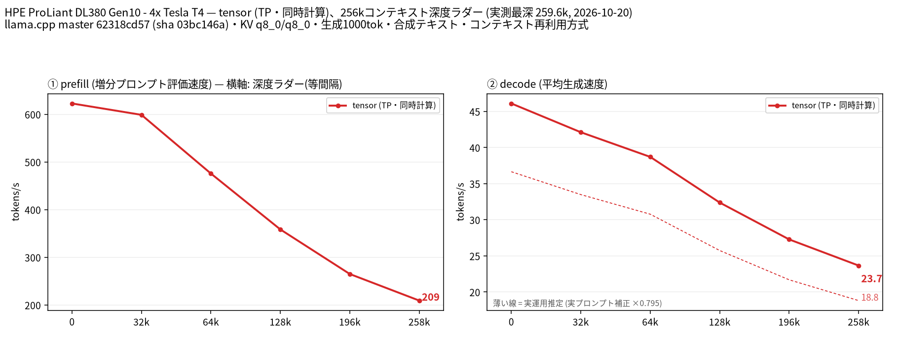
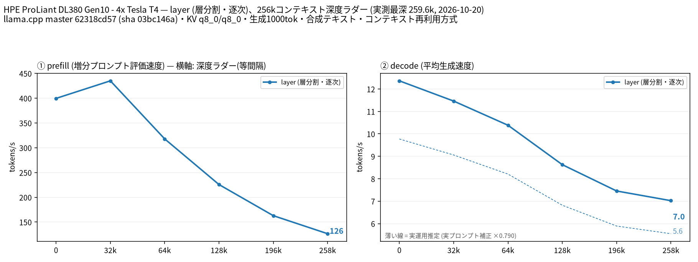
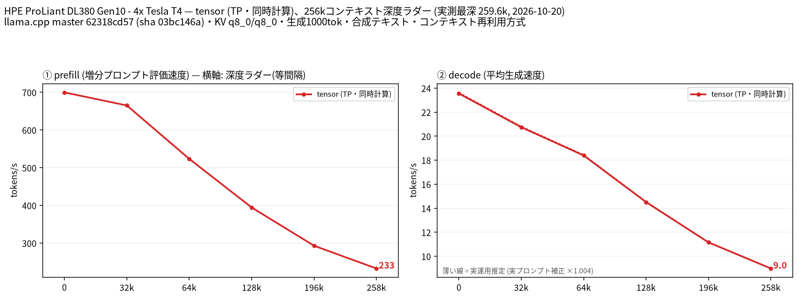
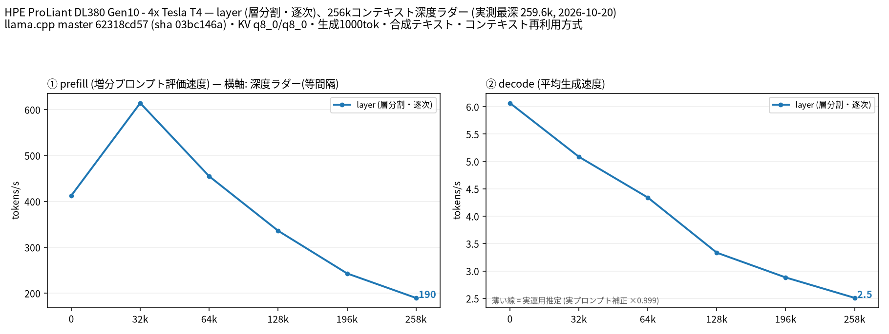

# Tesla T4 4 枚で Tess-4.5-27B Q8_0 を MTP 付きで 256k まで計測

- **作成者**: MG8853
- **作成日**: 2026-10-20

## 概要

HPE ProLiant DL380 Gen10 + Tesla T4 × 4（15 GB / 枚）で、[migtissera/Tess-4.5-27B-GGUF](https://huggingface.co/migtissera/Tess-4.5-27B-GGUF) の Q8_0（28.6 GB）と MTP ドラフトヘッド Q8_0（3.2 GB）を tensor 分割（TP=4）・KV q8_0 で、ネイティブ上限の 262,144 トークン（256k）まで計測しました。

32k で prefill 598.9 t/s / decode 42.1 t/s、258k で prefill 209.3 t/s / decode 23.7 t/s（MTP 採択率 0.991）でした。MTP を切った同一条件で比べると、256k の decode は tensor 9.0 t/s に対して layer 2.5 t/s で、tensor が約 3.6 倍速いという結果です（MTP ありでは 23.7 対 7.0 t/s。ただし layer 側はドラフトの配置・量子化が異なります）。MTP は tensor の decode を 0 深度で 1.96 倍、256k で 2.63 倍に伸ばし、T4×4 でも深いほど効きました。

コーディング評価（HumanEval 164 問、chat 形式、temperature 0）は **158/164 = 96.3%** でした。

## ハードウェア

| 項目 | 内容 |
|------|------|
| コンピュータ / マザーボード | HPE ProLiant DL380 Gen10 |
| GPU | Tesla T4 × 4（VRAM 15,360 MiB / 枚、電力上限 70 W / 枚） |
| GPU 接続 | PCIe 3.0 x16（`nvidia-smi` の current はアイドル時 Gen1 x16）。NVLink なし。`nvidia-smi topo -m` では GPU0-GPU1 が NODE、GPU2-GPU3 が NODE、この 2 組の間は SYS（NUMA ノードをまたぐ） |
| CPU | Intel Xeon Gold 6254 × 2（18 コア / 36 スレッド × 2、オンライン 72 論理 CPU） |
| メモリ | 232 GiB |
| 電源 | 不明 |

## ソフトウェア環境

| 項目 | 内容 |
|------|------|
| OS | Ubuntu 26.04.1 LTS / Linux 7.0.14-14-pve |
| GPU ドライバ | 615.71.09（CUDA 13.2 の `nvcc` でビルド） |
| llama.cpp | 0.7.0-dev（build 11709、commit `62318cd57`）、CUDA バックエンド（`CMAKE_CUDA_ARCHITECTURES=75`、`GGML_CUDA_FA=ON`、`GGML_CUDA_FA_ALL_QUANTS=ON`、Release）。NCCL 2.30.4 がリンクされている（`libggml-cuda.so` → `libnccl.so.2`） |
| ベンチマーク | llama-split-bench 7af72d4 |

## ベンチマーク

### 条件

| 項目 | 内容 |
|------|------|
| ツール | llama-split-bench 7af72d4 |
| モデル | `Tess-4.5-27B-Q8_0.gguf`（28,595,763,424 バイト、arch `qwen35`、64 ブロック、262,144 ctx、Gated DeltaNet + attention のハイブリッド、dense 27B） |
| MTP ヘッド | tensor: `mtp-Tess-4.5-27B-Q8_0.gguf`（3,164,006,560 バイト） / layer: `mtp-Tess-4.5-27B-Q4_K_M.gguf`（2,032,384,160 バイト）を `--spec-draft-device CUDA0` で 1 枚に固定 |
| 測定モード | tensor / layer（いずれも CUDA0〜CUDA3 の 4 枚、TP=4）それぞれ MTP あり・なしの計 4 本。Q8_0 は T4 1 枚に収まらないため単一 GPU は計測せず、図の第 4 パネルも無効 |
| ctx / stages | 262144 / 0,32000,64000,128000,196000,258000 |
| KV キャッシュ | q8_0 / q8_0（ドラフトも `-ctkd q8_0 -ctvd q8_0`） |
| 投機的デコード | `--spec-type draft-mtp --spec-draft-n-max 2`。MTP なしの腕では無効化 |
| その他 | `-fa on`、`-ngl all`、`-t 16`、`--parallel 1`、`--jinja`、`--cache-ram 8192 --cache-idle-slots --cache-reuse 256`、生成 1000 トークン / 段、PORT 18081、`LAUNCH_PREFIX` なし |

layer 分割では Q8_0 の MTP ヘッドが 262k で載りませんでした。ドラフトのコンテキスト生成時に CUDA3 で 2,209 MiB の確保に失敗する（`cudaMalloc failed: out of memory` → `failed to create MTP context`）ためで、Q4_K_M ヘッドを CUDA0 に固定して計測しています。したがって layer の数値は tensor とドラフト量子化が揃っていません（メイン側はどちらも Q8_0）。

### 結果（tensor + MTP Q8_0）

単位は t/s です。depth 0 の prefill は新規プロンプト（pp2048）の値です。depth 0 の decode と採択率は stage 0（11 トークンのプロンプト、生成 1000 トークン）の値です。ラダー初段の prefill は計測上のアーティファクトなので表に載せていません。

| depth | prefill | decode | MTP 採択率 |
|------:|------:|------:|------:|
| 0 | 622.82 | 46.11 | 0.969 |
| 32k | 598.94 | 42.13 | 0.997 |
| 64k | 475.78 | 38.71 | 0.996 |
| 128k | 358.54 | 32.39 | 1.000 |
| 196k | 265.02 | 27.28 | 0.996 |
| 258k | 209.31 | 23.66 | 0.991 |

深さ 0 の新規プロンプト prefill は pp512 535.7 / pp2048 622.8 / pp8192 676.3 t/s でした。

### 結果（layer + MTP Q4_K_M）

| depth | prefill | decode | MTP 採択率 |
|------:|------:|------:|------:|
| 0 | 399.62 | 12.36 | 0.969 |
| 32k | 435.05 | 11.46 | 0.996 |
| 64k | 317.84 | 10.38 | 0.996 |
| 128k | 225.70 | 8.63 | 0.997 |
| 196k | 162.87 | 7.45 | 0.996 |
| 258k | 126.46 | 7.02 | 0.996 |

深さ 0 の prefill は pp512 254.4 / pp2048 399.6 / pp8192 505.9 t/s でした。

### 結果（tensor・MTP なし）

| depth | prefill | decode |
|------:|------:|------:|
| 0 | 699.88 | 23.55 |
| 32k | 665.24 | 20.74 |
| 64k | 523.60 | 18.39 |
| 128k | 394.63 | 14.51 |
| 196k | 293.06 | 11.16 |
| 258k | 232.71 | 8.98 |

深さ 0 の prefill は pp512 618.8 / pp2048 699.9 / pp8192 734.8 t/s でした。MTP なしでは prefill がわずかに速く（258k で 232.7 対 209.3）、ドラフト側のプロンプト処理が上乗せされていることが分かります。

### 結果（layer・MTP なし）

| depth | prefill | decode |
|------:|------:|------:|
| 0 | 412.78 | 6.07 |
| 32k | 614.30 | 5.09 |
| 64k | 454.76 | 4.34 |
| 128k | 336.07 | 3.33 |
| 196k | 243.13 | 2.88 |
| 258k | 189.70 | 2.51 |

深さ 0 の prefill は pp512 254.9 / pp2048 412.8 / pp8192 622.4 t/s でした。直上の tensor（MTP なし）と条件が揃っているので、split-mode 自体の差はこの 2 本で比較しています。

### MTP と分割方式の比較（decode、t/s）

| depth | tensor MTP なし | layer MTP なし | tensor / layer（MTP なし） | tensor + MTP | layer + MTP（参考） | MTP の倍率（tensor） |
|------:|------:|------:|------:|------:|------:|------:|
| 0 | 23.55 | 6.07 | 3.88× | 46.11 | 12.36 | 1.96× |
| 32k | 20.74 | 5.09 | 4.07× | 42.13 | 11.46 | 2.03× |
| 64k | 18.39 | 4.34 | 4.24× | 38.71 | 10.38 | 2.10× |
| 128k | 14.51 | 3.33 | 4.36× | 32.39 | 8.63 | 2.23× |
| 196k | 11.16 | 2.88 | 3.88× | 27.28 | 7.45 | 2.44× |
| 258k | 8.98 | 2.51 | 3.58× | 23.66 | 7.02 | 2.63× |

`tensor / layer（MTP なし）` は両方とも投機的デコードを切った同一条件なので、split-mode だけの差です。一方 `layer + MTP` はドラフトを CUDA0 に固定し、量子化も Q4_K_M のため、`tensor + MTP`（ドラフト Q8_0 を 4 GPU に分散）との比較にはドラフト側の条件差（量子化・4 GPU 対 1 GPU 配置）が含まれます。そのため split-mode 自体の評価は MTP なしの 2 本で行っています。

### 実プロンプトでの補正（decode）

合成テキストのラダーはほぼ全トークンが採択される（採択率 0.99 前後）ため、実プロンプト 3 本（design / review / qa、各 1200 トークン、temperature 0.7 / top_p 0.9）でも decode を測りました。t/s は補正前の実測です。

| モード | design | review | qa | 実測の採択率（design / review / qa） | 補正係数 |
|------|------:|------:|------:|------|------:|
| tensor + MTP | 39.27 | 34.66 | 36.04 | 0.696 / 0.550 / 0.589 | 0.795 |
| layer + MTP | 10.97 | 8.81 | 9.54 | 0.798 / 0.544 / 0.630 | 0.790 |
| tensor MTP なし | 23.65 | 23.62 | 23.66 | — | 1.004 |
| layer MTP なし | 6.06 | 6.06 | 6.07 | — | 0.999 |

実プロンプトの採択率は 0.55〜0.80 で、合成テキスト（0.99）よりかなり低くなります。図の薄い破線はこの補正係数を全深度に掛けた「実運用推定」です。MTP なしの腕は補正係数がほぼ 1.0 なので、破線と実線が重なります。

補正係数（tensor + MTP は 0.795、layer + MTP は 0.790、MTP なしは 1.004 / 0.999 でほぼ 1.0）を各深度の実測 decode に掛けた推定値は次のとおりです。上の実プロンプト計測は入力が 58〜73 トークンの浅い深度で行っているため、その値（35〜39 t/s）を長文脈の実運用速度として使うことはできません。

| depth | tensor + MTP | layer + MTP |
|------:|------:|------:|
| 0 | 36.7 | 9.8 |
| 32k | 33.5 | 9.1 |
| 64k | 30.8 | 8.2 |
| 128k | 25.8 | 6.8 |
| 196k | 21.7 | 5.9 |
| 258k | 18.8 | 5.6 |

### VRAM 使用量（258k、起動直後）

| 構成 | CUDA0 | CUDA1 | CUDA2 | CUDA3 |
|------|------:|------:|------:|------:|
| tensor + MTP Q8_0 | 12,351 | 12,351 | 12,351 | 12,351 |
| tensor MTP なし | 10,311 | 10,311 | 10,311 | 10,311 |
| layer（MTP なし） | 11,163 | 10,679 | 10,679 | 11,577 |
| layer + MTP Q4_K_M（CUDA0 固定） | 14,391 | 10,751 | 10,751 | 11,641 |

単位は MiB です。tensor + MTP Q8_0 は 1 枚あたり約 3.0 GiB の余裕があり、256k は安定して動きます。layer + MTP は CUDA0 が 14,391 MiB と上限（15,360 MiB）に近く、Q8_0 ヘッドでは入りませんでした。

### コーディング評価（HumanEval）

HumanEval の全 164 問を、chat 形式（system で「関数を完成させ、コードブロックのみ返す」と指示）、temperature 0、max_tokens 768、`enable_thinking: false` で解かせ、公式のテストコードを subprocess（10 秒タイムアウト）で実行しました。サーバは tensor 分割・KV q8_0・MTP Q8_0 ヘッド・`-c 8192` です。プロンプト形式は公式の completion 形式ではなく chat 形式なので、公式スコアと直接比較する場合は注意してください。

| 指標 | 結果 |
|------|------|
| pass@1 | **158/164 = 96.3%** |
| 1 問あたりの平均時間 | 5.7 秒 |
| 合計生成トークン | 36,975（1 問あたり平均 225.5） |

同一ハーネス・同一ビルドでの横断比較（HumanEval 164 問、chat 形式、temperature 0、max_tokens 768、`enable_thinking: false`、10 秒タイムアウト、`-c 8192`・KV q8_0・MTP n-max 2）。参考値は同じマシン・同じ llama.cpp ビルド（11709）で 2026-10-18 に測ったもので、各測定の集計 JSON を添付しています（分割モードは Nemotron のみ layer、他は tensor）。

| モデル | 量子化 | 分割 | 測定日 | pass@1 | 1 問あたり平均時間 | 集計 JSON |
|--------|------|------|------|------:|------:|------|
| Tess-4.5-27B + MTP | Q8_0 | tensor | 2026-10-20 | **158/164 = 96.3%** | 5.7 秒 | [tess-q8-humanEval.json](attachment/2026-10-20_153835_profiling_tess_4.5_27b_q8_0_with_mtp_up_to_256k_on_4x_tesla_t4/tess-q8-humanEval.json) |
| Qwen3.8 27B Uncensored + MTP | Q5_K_M | tensor | 2026-10-18 | 156/164 = 95.1% | 5.43 秒 | [qwen-unc-humanEval.json](attachment/2026-10-20_153835_profiling_tess_4.5_27b_q8_0_with_mtp_up_to_256k_on_4x_tesla_t4/reference-humaneval/qwen-unc-humanEval.json) |
| Ornith-1.5 35B A3B + MTP | Q4_K_M | tensor | 2026-10-18 | 147/164 = 89.6% | 2.46 秒 | [ornith-1.5-35b-a3b-humanEval.json](attachment/2026-10-20_153835_profiling_tess_4.5_27b_q8_0_with_mtp_up_to_256k_on_4x_tesla_t4/reference-humaneval/ornith-1.5-35b-a3b-humanEval.json) |
| Ornith-1.5 35B A3B Uncensored + MTP | Q4_K_M | tensor | 2026-10-18 | 145/164 = 88.4% | 2.96 秒 | [ornith-1.5-35b-a3b-uncensored-humanEval.json](attachment/2026-10-20_153835_profiling_tess_4.5_27b_q8_0_with_mtp_up_to_256k_on_4x_tesla_t4/reference-humaneval/ornith-1.5-35b-a3b-uncensored-humanEval.json) |
| Nemotron 3.5 Lightning 30B A3B CRACK + MTP | Q4_K_M | layer | 2026-10-18 | 143/164 = 87.2% | 3.87 秒 | [nemotron-3.5-lightning-30b-a3b-crack-humanEval.json](attachment/2026-10-20_153835_profiling_tess_4.5_27b_q8_0_with_mtp_up_to_256k_on_4x_tesla_t4/reference-humaneval/nemotron-3.5-lightning-30b-a3b-crack-humanEval.json) |

Qwen3.8 27B Uncensored は Q5_K_M、Tess は Q8_0 で、モデルも量子化も異なるため厳密な比較ではありません。また `enable_thinking: false` で走らせているので、Tess の売りである「同じ正答率を 25% 少ないトークンで」という主張はこの計測では検証できていません（1 問あたりの生成トークンは 225.5 対 228.8 でほぼ同じでした）。

## 所感

- **256k は Q8_0 + MTP Q8_0 + tensor 分割で問題なく動きます。** 258k 深度（実効 259,601 トークン）で prefill 209.3 / decode 23.66 t/s、起動時の VRAM は 12,351 MiB / 枚で約 3 GiB の余裕があります。262,144 がネイティブ上限なので YaRN は使っていません。
- **T4×4 では tensor 分割が圧倒的に有利**です。投機的デコードを切った同一条件では、decode が layer の 3.58〜4.36 倍、prefill も深度 0 で 1.70 倍、深いところでは 1.1〜1.2 倍でした。MTP ありでも decode は 3.4〜3.8 倍ですが、layer 側はドラフトを 1 枚に載せているぶん不利なので、split-mode 自体の効果は MTP なしの比較で判断するのが妥当です。前回の Qwen3.8 27B の計測（MTP あり、decode で約 3.2 倍）と同じ傾向で、T4 のように PCIe 接続で NVLink がない構成では layer 分割を選ぶ理由が見つかりません。
- **MTP は T4×4 でも約 2 倍、深いほど効きます。** decode は 0 深度で 1.96 倍、256k で 2.63 倍でした。dense 27B の decode はメモリ帯域律速で、深くなるほど 1 トークンあたりのコストが上がるため、1 サイクルで複数トークンを出す MTP の相対的な効果が大きくなると考えられます。ただし合成テキストの採択率は 0.99 と楽観側で、実プロンプトでは 0.55〜0.80 まで下がります。実プロンプト 3 本を流した浅い深度（入力 58〜73 トークン）では 35〜39 t/s ですが、これは depth 0 相当の値で、補正係数 0.795 を 256k の 23.66 t/s に掛けると約 18.8 t/s になります。長文脈での実運用は 20 t/s 前後、32k 前後なら 33 t/s 前後と見るのが妥当です。
- **layer 分割 + 262k では MTP ヘッドの置き場所が問題になります。** Q8_0 ヘッド（3.2 GB）は CUDA3 の空きに収まらずロードに失敗し、Q4_K_M ヘッドを CUDA0 に固定して初めて起動できました。それでも CUDA0 は 14,391 MiB で余裕は 1 GB 弱です。layer 分割で長文脈 + MTP を使うなら、ヘッドの量子化を落とすか、コンテキストを 128k 程度に抑える必要があります。
- **prefill は MTP なしのほうがわずかに速い**（258k で 232.7 対 209.3 t/s）。ドラフト側もプロンプトを処理するためで、MTP は decode 向けの機能だと分かります。
- **HumanEval は 158/164 = 96.3%** で、同ハーネスで測った Qwen3.8 27B Uncensored（156/164）より 2 問多い結果でした。ただし量子化が違い（Q8_0 対 Q5_K_M）、1 回の測定なので誤差の範囲です。Tess はベースの Qwen3.8-27B と同等のコーディング能力を持つという主張と矛盾しない結果です。
- 速度面では、Qwen3.8 27B の Q8_0（前回、同一マシン・tensor・MTP）が 0 深度 48.43 / 258k 25.08 t/s だったのに対し、Tess は 46.11 / 23.66 t/s で、約 5% 遅い結果でした。ただし前回の Q8_0 は nextn 層を持たず外部の `mtp-Qwen3.8-27B-Q4_0.gguf`（1.37 GB）を `-md` で指定しており、Tess は外部の Q8_0 ヘッド（3.16 GB）です。MTP ヘッドの量子化と llama.cpp のビルド差（build 11195 → 11709）が含まれるため、この差をモデル由来と断定はできません。
- エージェント用途で気になるのは、実プロンプトでの採択率の低さ（0.55〜0.80）です。コーディングのように出力の予測が効きやすいタスクでは採択率が上がる可能性があり、HumanEval の 5.7 秒 / 問は Qwen3.8 27B Uncensored の 5.43 秒 / 問と同程度でした。

## 添付

- tensor + MTP: [split-bench-ja.png](attachment/2026-10-20_153835_profiling_tess_4.5_27b_q8_0_with_mtp_up_to_256k_on_4x_tesla_t4/tensor-mtp/split-bench-ja.png) / [split-bench-en.png](attachment/2026-10-20_153835_profiling_tess_4.5_27b_q8_0_with_mtp_up_to_256k_on_4x_tesla_t4/tensor-mtp/split-bench-en.png) / [run-info.json](attachment/2026-10-20_153835_profiling_tess_4.5_27b_q8_0_with_mtp_up_to_256k_on_4x_tesla_t4/tensor-mtp/run-info.json) / [results-tensor.json](attachment/2026-10-20_153835_profiling_tess_4.5_27b_q8_0_with_mtp_up_to_256k_on_4x_tesla_t4/tensor-mtp/results-tensor.json) / [results-tensor-pp0.json](attachment/2026-10-20_153835_profiling_tess_4.5_27b_q8_0_with_mtp_up_to_256k_on_4x_tesla_t4/tensor-mtp/results-tensor-pp0.json) / [results-real.json](attachment/2026-10-20_153835_profiling_tess_4.5_27b_q8_0_with_mtp_up_to_256k_on_4x_tesla_t4/tensor-mtp/results-real.json) / [argv-tensor.txt](attachment/2026-10-20_153835_profiling_tess_4.5_27b_q8_0_with_mtp_up_to_256k_on_4x_tesla_t4/tensor-mtp/argv-tensor.txt)
- layer + MTP: [split-bench-ja.png](attachment/2026-10-20_153835_profiling_tess_4.5_27b_q8_0_with_mtp_up_to_256k_on_4x_tesla_t4/layer-mtp/split-bench-ja.png) / [split-bench-en.png](attachment/2026-10-20_153835_profiling_tess_4.5_27b_q8_0_with_mtp_up_to_256k_on_4x_tesla_t4/layer-mtp/split-bench-en.png) / [run-info.json](attachment/2026-10-20_153835_profiling_tess_4.5_27b_q8_0_with_mtp_up_to_256k_on_4x_tesla_t4/layer-mtp/run-info.json) / [results-layer.json](attachment/2026-10-20_153835_profiling_tess_4.5_27b_q8_0_with_mtp_up_to_256k_on_4x_tesla_t4/layer-mtp/results-layer.json) / [results-layer-pp0.json](attachment/2026-10-20_153835_profiling_tess_4.5_27b_q8_0_with_mtp_up_to_256k_on_4x_tesla_t4/layer-mtp/results-layer-pp0.json) / [results-real.json](attachment/2026-10-20_153835_profiling_tess_4.5_27b_q8_0_with_mtp_up_to_256k_on_4x_tesla_t4/layer-mtp/results-real.json) / [argv-layer.txt](attachment/2026-10-20_153835_profiling_tess_4.5_27b_q8_0_with_mtp_up_to_256k_on_4x_tesla_t4/layer-mtp/argv-layer.txt)
- tensor MTP なし: [split-bench-ja.png](attachment/2026-10-20_153835_profiling_tess_4.5_27b_q8_0_with_mtp_up_to_256k_on_4x_tesla_t4/tensor-nomtp/split-bench-ja.png) / [split-bench-en.png](attachment/2026-10-20_153835_profiling_tess_4.5_27b_q8_0_with_mtp_up_to_256k_on_4x_tesla_t4/tensor-nomtp/split-bench-en.png) / [run-info.json](attachment/2026-10-20_153835_profiling_tess_4.5_27b_q8_0_with_mtp_up_to_256k_on_4x_tesla_t4/tensor-nomtp/run-info.json) / [results-tensor.json](attachment/2026-10-20_153835_profiling_tess_4.5_27b_q8_0_with_mtp_up_to_256k_on_4x_tesla_t4/tensor-nomtp/results-tensor.json) / [results-tensor-pp0.json](attachment/2026-10-20_153835_profiling_tess_4.5_27b_q8_0_with_mtp_up_to_256k_on_4x_tesla_t4/tensor-nomtp/results-tensor-pp0.json) / [results-real.json](attachment/2026-10-20_153835_profiling_tess_4.5_27b_q8_0_with_mtp_up_to_256k_on_4x_tesla_t4/tensor-nomtp/results-real.json) / [argv-tensor.txt](attachment/2026-10-20_153835_profiling_tess_4.5_27b_q8_0_with_mtp_up_to_256k_on_4x_tesla_t4/tensor-nomtp/argv-tensor.txt)
- layer MTP なし: [split-bench-ja.png](attachment/2026-10-20_153835_profiling_tess_4.5_27b_q8_0_with_mtp_up_to_256k_on_4x_tesla_t4/layer-nomtp/split-bench-ja.png) / [split-bench-en.png](attachment/2026-10-20_153835_profiling_tess_4.5_27b_q8_0_with_mtp_up_to_256k_on_4x_tesla_t4/layer-nomtp/split-bench-en.png) / [run-info.json](attachment/2026-10-20_153835_profiling_tess_4.5_27b_q8_0_with_mtp_up_to_256k_on_4x_tesla_t4/layer-nomtp/run-info.json) / [results-layer.json](attachment/2026-10-20_153835_profiling_tess_4.5_27b_q8_0_with_mtp_up_to_256k_on_4x_tesla_t4/layer-nomtp/results-layer.json) / [results-layer-pp0.json](attachment/2026-10-20_153835_profiling_tess_4.5_27b_q8_0_with_mtp_up_to_256k_on_4x_tesla_t4/layer-nomtp/results-layer-pp0.json) / [results-real.json](attachment/2026-10-20_153835_profiling_tess_4.5_27b_q8_0_with_mtp_up_to_256k_on_4x_tesla_t4/layer-nomtp/results-real.json) / [argv-layer.txt](attachment/2026-10-20_153835_profiling_tess_4.5_27b_q8_0_with_mtp_up_to_256k_on_4x_tesla_t4/layer-nomtp/argv-layer.txt)
- [tess-q8-humanEval.json](attachment/2026-10-20_153835_profiling_tess_4.5_27b_q8_0_with_mtp_up_to_256k_on_4x_tesla_t4/tess-q8-humanEval.json)
- 参考モデルの集計 JSON: [qwen-unc-humanEval.json](attachment/2026-10-20_153835_profiling_tess_4.5_27b_q8_0_with_mtp_up_to_256k_on_4x_tesla_t4/reference-humaneval/qwen-unc-humanEval.json) / [ornith-1.5-35b-a3b-humanEval.json](attachment/2026-10-20_153835_profiling_tess_4.5_27b_q8_0_with_mtp_up_to_256k_on_4x_tesla_t4/reference-humaneval/ornith-1.5-35b-a3b-humanEval.json) / [ornith-1.5-35b-a3b-uncensored-humanEval.json](attachment/2026-10-20_153835_profiling_tess_4.5_27b_q8_0_with_mtp_up_to_256k_on_4x_tesla_t4/reference-humaneval/ornith-1.5-35b-a3b-uncensored-humanEval.json) / [nemotron-3.5-lightning-30b-a3b-crack-humanEval.json](attachment/2026-10-20_153835_profiling_tess_4.5_27b_q8_0_with_mtp_up_to_256k_on_4x_tesla_t4/reference-humaneval/nemotron-3.5-lightning-30b-a3b-crack-humanEval.json)

